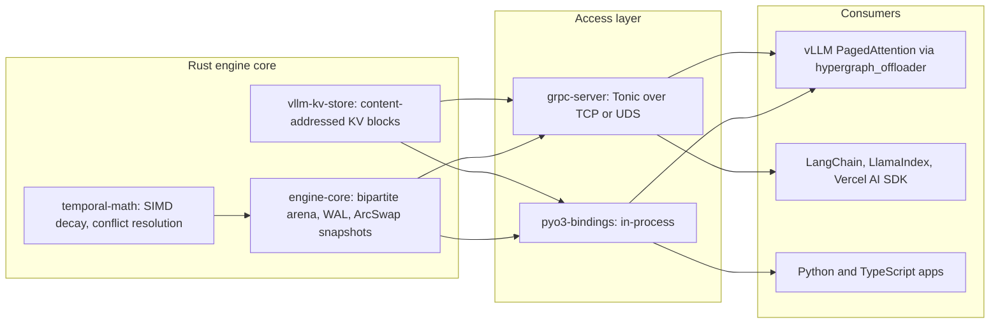

# Temporal Hypergraph Engine

**Sub-millisecond temporal graph database and KV-offloader for RAG that never serves stale facts.**

Temporal Hypergraph Engine stores knowledge as time-bounded N-ary hyperedges ("Satya Nadella was CEO of Microsoft *from 2014*"), so a multi-hop traversal at any point in time only follows facts that were true then. Superseded facts are neither returned nor expanded. The engine is written in Rust, reads lock-free from immutable snapshots, and is reachable in-process through PyO3, over gRPC, or as a secondary KV-cache tier for vLLM PagedAttention.

- **0% stale-fact contamination** in multi-hop retrieval, against 53% for flat vector RAG and 45% for naive Graph RAG.
- **0.53 ms p50** 3-hop temporal retrieval, about 8x faster than the same traversal in NetworkX.
- **Under 1 µs** p99 snapshot acquisition under a heavy writer, against about 40 ms for an `RwLock`.

[Benchmarks](#benchmarks) · [Whitepaper metrics](docs/GTM_Whitepaper_Metrics.md) · [Design docs](docs/) · [License](#license)

## Quickstart

Start the server (gRPC on `localhost:50051`; set `HYPERGRAPH_API_KEY` to require a key):

```bash
cargo run --release -p grpc-server --bin hypergraph-server -- --data-dir ./data
```

Then add temporal memory in one line from your framework of choice.

**Python**

```python
from hypergraph_client import TemporalHypergraph; memory = TemporalHypergraph(api_key="your_key")
```

**LangChain**

```python
from langchain_hypergraph import TemporalHypergraph; memory = TemporalHypergraph(api_key="your_key", session_id="user-42")
```

**LlamaIndex**

```python
from llama_index_hypergraph import TemporalHypergraph; memory = TemporalHypergraph(api_key="your_key", session_id="user-42")
```

**TypeScript (Vercel AI SDK)**

```ts
import { TemporalHypergraph } from "@temporal-hypergraph/sdk"; const memory = new TemporalHypergraph({ apiKey: "your_key" });
```

**In-process, no server (PyO3)**

```python
from hypergraph_engine_native import NativeHypergraphEngine

engine = NativeHypergraphEngine.in_memory()
engine.insert_hyperedge_fast("CEO_OF", ["person:nadella", "org:microsoft"], 1391212800, None, b"")
engine.traverse(["org:microsoft"], k_hops=3, as_of=1700000000)
```

Each integration has its own README with the full API: [Python client](integrations/python-client/README.md), [LangChain](integrations/langchain/README.md), [LlamaIndex](integrations/llamaindex/README.md), [Vercel AI SDK](integrations/vercel-ai-sdk/README.md).

## Architecture



<details>
<summary>ASCII version</summary>

```text
+---------------------------- Rust engine core -----------------------------+
|  temporal-math  -->  engine-core (arena + WAL + ArcSwap)  |  vllm-kv-store |
+------------------------------+-------------------------------+------------+
                               |                               |
              +----------------+---------------+               |
              v                                v               v
     pyo3-bindings (in-process)      grpc-server (Tonic, TCP/UDS)
              |                                |
     +--------+---------+            +---------+-------------------------+
     v                  v            v                                   v
 vLLM PagedAttention  Python apps   LangChain / LlamaIndex / Vercel AI   vLLM (remote)
 (hypergraph_offloader)
```

</details>

## Benchmarks

Phase 7 results on an Apple M3 (8 cores, 8 GB RAM), offline with no LLM calls. Full tables, methodology and reproduction commands are in [docs/GTM_Whitepaper_Metrics.md](docs/GTM_Whitepaper_Metrics.md).

**Lock-free reads under a heavy writer** (8 reader threads running 3-hop traversals over 1M hyperedges, one unthrottled writer):

| | ArcSwap (this engine) | RwLock control |
|---|---|---|
| Snapshot / lock acquire p99 | 375 ns | 40.0 ms |
| Reader throughput | 14.8K reads/s | 1.0K reads/s |
| Writer throughput | 25.2K edges/s | 31.3K edges/s |

**Multi-hop retrieval accuracy** (12,000 entities, 60,000 temporal facts, 1,000 questions about past dates, MiniLM embeddings):

| Contender | Fact recall | Full-chain recall | Stale-fact rate | Context tokens |
|---|---|---|---|---|
| **Temporal Hypergraph** | **62.2%** | **36.2%** | **0.0%** | 666 |
| NetworkX graph, temporal filter | 62.3% | 36.3% | 0.0% | 666 |
| NetworkX graph, naive BFS (Graph RAG) | 49.0% | 11.8% | 45.1% | 689 |
| FAISS exact cosine, token-matched k=8 (Vector RAG) | 8.6% | 1.4% | 52.5% | 656 |

**Retrieval latency** (same workload, in-process, query embedding excluded):

| Contender | p50 | p99 |
|---|---|---|
| **Temporal Hypergraph (PyO3)** | **0.53 ms** | **11.1 ms** |
| NetworkX graph, temporal filter | 4.13 ms | 79.1 ms |
| NetworkX graph, naive BFS | 5.08 ms | 78.8 ms |
| FAISS exact cosine, k=8 | 0.47 ms | 2.96 ms |

**Ingest:** 200K edges/s sustained over the first 2M hyperedges in memory (peak 314K/s), about 320 MiB of heap per million edges, single-write p99 of 2.2 ms.

The retrieval data is synthetic and template-generated, and the 10M-edge ingest target needs a machine with more than 8 GB of RAM. See the whitepaper's methodology section for these limitations.

## Repository layout

| Path | Contents |
|---|---|
| [`crates/engine-core`](crates/engine-core) | Bipartite-arena hypergraph storage, WAL durability, lock-free snapshot reads |
| [`crates/temporal-math`](crates/temporal-math) | Time-decay scoring, Fourier time encodings, temporal conflict resolution |
| [`crates/grpc-server`](crates/grpc-server) | Tonic gRPC server (`hypergraph-server`) over TCP or Unix sockets |
| [`crates/pyo3-bindings`](crates/pyo3-bindings) | In-process Python module `hypergraph_engine_native` |
| [`crates/vllm-kv-store`](crates/vllm-kv-store) | Content-addressed secondary tier for vLLM KV-cache blocks |
| [`python/hypergraph_offloader`](python/hypergraph_offloader) | vLLM connector for the KV tier |
| [`python/evaluation`](python/evaluation) | Extraction, F1 evaluation, LLM failover router, competitor benchmark |
| [`integrations/`](integrations) | Python client, LangChain, LlamaIndex, Vercel AI SDK |
| [`benchmarks/`](benchmarks) | Scale, concurrency and report-generation benchmarks |
| [`proto/`](proto) | gRPC service definition |
| [`tests/`](tests) | Chaos (SIGKILL, WAL corruption) and Python integration tests |

## Building from source

Requires Rust 1.80+, Python 3.10+, and Node 18+ for the TypeScript SDK.

```bash
cargo build --release --workspace
cargo test --workspace

python -m venv .venv && source .venv/bin/activate
pip install maturin
(cd crates/pyo3-bindings && maturin develop --release)
pip install -e integrations/python-client -e integrations/langchain -e integrations/llamaindex

(cd integrations/vercel-ai-sdk && npm ci && npm run build)
```

On macOS, see the [local development guide](docs/07-mac-local-development-guide.txt) for CPU fallbacks and remote GPU setup.

## Documentation

1. [Core storage engine](docs/01-core-storage-engine.txt)
2. [Temporal decay math](docs/02-temporal-decay-math.txt)
3. [gRPC and IPC API](docs/03-grpc-ipc-api.txt)
4. [vLLM KV offloader](docs/04-vllm-kv-offloader.txt)
5. [Extraction benchmarks](docs/05-extraction-benchmarks.txt)
6. [Test and validation plan](docs/06-test-and-validation-plan.txt)
7. [macOS local development guide](docs/07-mac-local-development-guide.txt)
8. [Performance and competitor metrics](docs/GTM_Whitepaper_Metrics.md)

## License

Licensed under either of [Apache License, Version 2.0](LICENSE-APACHE) or [MIT license](LICENSE-MIT), at your option.

Unless you explicitly state otherwise, any contribution intentionally submitted for inclusion in this project by you, as defined in the Apache-2.0 license, shall be dual licensed as above, without any additional terms or conditions.
