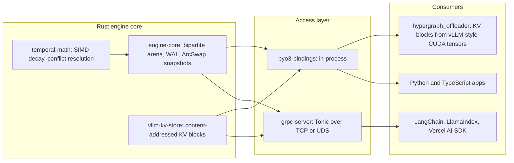

<div align="center">

# ⚡ Temporal Hypergraph Engine (v2.0)

**A lock-free, SIMD-accelerated temporal hypergraph database written in Rust, with a zero-copy KV-cache block store for vLLM.**

[](LICENSE)
[](https://pypi.org/project/hypergraph-client/)
[](https://pypi.org/project/hypergraph-engine-native/)
[](https://www.npmjs.com/package/@temporal-hypergraph/sdk)
[](https://github.com/Divyansh151005/Temporal-Hypergraph-Engine/actions/workflows/publish.yml)
[](https://github.com/Divyansh151005/Temporal-Hypergraph-Engine/actions/workflows/engine-validation.yml)
[](https://doc.rust-lang.org/edition-guide/rust-2021/)

[Quickstart](#quickstart) · [Benchmarks](#benchmarks) · [Architecture](#architecture) · [Whitepaper metrics](docs/GTM_Whitepaper_Metrics.md) · [Design docs](docs/) · [Licensing](#licensing-and-commercial-use)

</div>

---

Retrieval-augmented LLMs fail quietly when the knowledge base remembers facts that are no longer true. Temporal Hypergraph Engine stores knowledge as **time-bounded N-ary hyperedges** ("Satya Nadella was CEO of Microsoft *from 2014*"), so a multi-hop traversal at any point in time only follows facts that were true then. Superseded facts are neither returned nor expanded.

The engine is written in Rust, reads lock-free from immutable `ArcSwap` snapshots, and is reachable in-process through PyO3 or over gRPC. The same process also hosts a content-addressed **KV-cache block store** with a Python offloader built for vLLM: blocks copied from GPU into the engine and back are bit-for-bit identical.

## Why it exists

- **Zero stale facts.** 0% stale-fact contamination in multi-hop retrieval, against roughly 50% for flat vector RAG and 45 to 48% for naive Graph RAG.
- **Fast at scale.** 2.95 ms p50 3-hop temporal retrieval over 100K entities and 500K facts, 8.0 to 9.4x faster than the same traversal in NetworkX.
- **Never blocks readers.** Under 1 µs p99 snapshot acquisition under an unthrottled writer, against about 40 ms for an `RwLock`.
- **Built for LLM serving.** A raw-pointer KV block tier that survived 500 vLLM generations and 50 offload cycles with 0 mismatches and no VRAM growth.
- **Drop-in for your stack.** Python, LangChain, LlamaIndex, TypeScript and the Vercel AI SDK, all speaking one gRPC protocol.

## Benchmarks

### Extreme-scale run (Kaggle, Tesla T4 instance)

Run on a Kaggle GPU instance (4-vCPU Intel Xeon @ 2.0 GHz, 32 GB RAM, Tesla T4 16 GB). The ingest and retrieval benchmarks run on the CPU; the soak test runs vLLM on the T4. Raw output: [`results/extreme_scale/`](results/extreme_scale/).

| Benchmark | Workload | Result |
|---|---|---|
| **10M-edge ingest** | 10,000,000 hyperedges (arity 2 to 4) over 2M nodes, in memory | **85.6 s** wall time, **~117K edges/s sustained**, **227K edges/s peak**, 3.21 GiB peak RSS, 0 failed inserts |
| **Temporal retrieval** | 100K entities, 500K facts, 1,000 three-hop questions | **2.95 ms p50**, **8.0x** faster than NetworkX with a temporal filter, **9.4x** faster than naive NetworkX BFS, **0% stale facts** |
| **vLLM soak** | Qwen2.5-1.5B on vLLM, 500 generations, a 32-block offload/restore cycle every 10 | **1,600 blocks**, **0 mismatches** (bit-exact), **0 leftover blocks**, **+0 B VRAM**, **+0.2 MiB anonymous heap** |

Full retrieval comparison for the 100K-entity run (hashing embedder, no LLM calls):

| Contender | p50 | p99 | Recall | F1 | Stale-fact rate |
|---|---|---|---|---|---|
| **Temporal Hypergraph** | **2.95 ms** | **119 ms** | **51.3%** | **0.125** | **0.0%** |
| NetworkX graph, temporal filter | 23.7 ms | 583 ms | 51.4% | 0.125 | 0.0% |
| NetworkX graph, naive BFS (Graph RAG) | 27.8 ms | 607 ms | 31.6% | 0.071 | 47.7% |
| FAISS exact cosine, k=5 (Vector RAG) | 21.9 ms | 26.2 ms | 0.7% | 0.001 | 48.8% |
| FAISS exact cosine, k=12 (Vector RAG) | 21.7 ms | 24.5 ms | 0.9% | 0.001 | 50.2% |

The temporal NetworkX baseline applies the same validity filter, so it matches our accuracy by construction; the comparison isolates engine speed. Absolute F1 is low because the graph contenders return a fixed context of up to 16 facts for questions that have two gold facts, which caps precision at 12.5%; recall and stale-fact rate are the metrics that matter for RAG context quality.

> **Memory behavior.** Append-only segment storage uses file-backed pages. During the soak test, resident memory grew by 618 MiB of file-backed pages, matching the 630 MiB of KV data appended to segments, while anonymous heap grew by 0.2 MiB and VRAM by 0 B. Segment compaction is scheduled for v2.1.0.

### Phase 7 results (Apple M3)

Apple M3 (8 cores, 8 GB RAM), offline with no LLM calls. Methodology and reproduction commands: [docs/GTM_Whitepaper_Metrics.md](docs/GTM_Whitepaper_Metrics.md).

<details>
<summary><b>Lock-free reads under a heavy writer</b></summary>

8 reader threads running 3-hop traversals over 1M hyperedges, one unthrottled writer:

| | ArcSwap (this engine) | RwLock control |
|---|---|---|
| Snapshot / lock acquire p99 | 375 ns | 40.0 ms |
| Reader throughput | 14.8K reads/s | 1.0K reads/s |
| Writer throughput | 25.2K edges/s | 31.3K edges/s |

</details>

<details>
<summary><b>Multi-hop retrieval accuracy and latency</b> (12K entities, 60K facts, MiniLM embeddings)</summary>

1,000 questions about past dates:

| Contender | Fact recall | Full-chain recall | Stale-fact rate | Context tokens |
|---|---|---|---|---|
| **Temporal Hypergraph** | **62.2%** | **36.2%** | **0.0%** | 666 |
| NetworkX graph, temporal filter | 62.3% | 36.3% | 0.0% | 666 |
| NetworkX graph, naive BFS (Graph RAG) | 49.0% | 11.8% | 45.1% | 689 |
| FAISS exact cosine, token-matched k=8 (Vector RAG) | 8.6% | 1.4% | 52.5% | 656 |

Latency on the same workload, in-process, query embedding excluded:

| Contender | p50 | p99 |
|---|---|---|
| **Temporal Hypergraph (PyO3)** | **0.53 ms** | **11.1 ms** |
| NetworkX graph, temporal filter | 4.13 ms | 79.1 ms |
| NetworkX graph, naive BFS | 5.08 ms | 78.8 ms |
| FAISS exact cosine, k=8 | 0.47 ms | 2.96 ms |

</details>

**Ingest on M3:** 200K edges/s sustained over the first 2M hyperedges (peak 314K/s), about 320 MiB of heap per million edges, single-write p99 of 2.2 ms.

**Limitations.** Retrieval datasets are synthetic and template-generated. Baselines are an in-process NetworkX property graph and exact FAISS, not Neo4j or a hosted vector database. Tail latency (p99) sits well above p50; the whitepaper's engineering notes cover the two known causes, snapshot reclamation on the read path and copy-on-write publish cost on large graphs. See its methodology section for details.

## Architecture

```text
 ┌──────────────────────────────── Rust core engine ────────────────────────────────┐
 │                                                                                  │
 │   temporal-math                engine-core                     vllm-kv-store     │
 │  ┌──────────────────┐   ┌───────────────────────────┐   ┌─────────────────────┐  │
 │  │ SIMD time decay  │──▶│ Bipartite arena allocator │   │ BLAKE3 content-     │  │
 │  │ Fourier encoding │   │ ArcSwap lock-free index   │   │ addressed KV blocks │  │
 │  │ conflict resolve │   │ Write-ahead log + fsync   │   │ 64B-aligned mmap    │  │
 │  └──────────────────┘   │ Immutable read snapshots  │   │ append-only segments│  │
 │                         └─────────────┬─────────────┘   └──────────┬──────────┘  │
 └───────────────────────────────────────┼────────────────────────────┼─────────────┘
                     ┌───────────────────┴──────────┬─────────────────┘
                     ▼                              ▼
       ┌───────────────────────────┐   ┌───────────────────────────────┐
       │ pyo3-bindings (FFI)       │   │ grpc-server (Tonic)           │
       │ hypergraph_engine_native  │   │ TCP :50051 or Unix socket     │
       │ in-process, raw pointers  │   │ API-key auth, streaming       │
       └─────┬───────────────┬─────┘   └───────────────┬───────────────┘
             ▼               ▼                         ▼
 ┌───────────────────┐ ┌───────────┐   ┌──────────────────────────────────────────┐
 │ hypergraph-       │ │ Python    │   │ hypergraph-client · langchain-hypergraph │
 │ offloader         │ │ apps      │   │ llama-index-hypergraph · @temporal-      │
 │ CUDA ⇄ engine     │ │           │   │ hypergraph/sdk (Vercel AI SDK)           │
 │ KV blocks (vLLM)  │ │           │   │                                          │
 └───────────────────┘ └───────────┘   └──────────────────────────────────────────┘
```

<details>
<summary>Mermaid version</summary>



</details>

- **Writes** append to a write-ahead log, land in the arena, and publish a new immutable snapshot with a single atomic pointer swap.
- **Reads** load the current snapshot without taking a lock, so a heavy writer never stalls a traversal.
- **Traversals** filter every hop by validity interval at `as_of`, then score by confidence times exponential time decay (and cosine similarity when you pass an embedding).
- **KV blocks** are keyed by a BLAKE3 hash of their token prefix, deduplicated, and can be tied to hyperedges so eviction uses the same temporal decay.

## Quickstart

### 1. Start the server

The prebuilt image serves gRPC on `localhost:50051`; no Rust toolchain needed.

```bash
docker run -d -p 50051:50051 ghcr.io/divyansh151005/temporal-hypergraph-server:2.0.0
```

Add `-v thg-data:/data` to keep data across restarts and `-e HYPERGRAPH_API_KEY=your_key` to require a key. To build from source instead, run `docker build -t temporal-hypergraph-server .` or `cargo run --release -p grpc-server --bin hypergraph-server -- --data-dir ./data`.

### 2. Python: temporal facts and point-in-time traversal

```bash
pip install hypergraph-client
```

```python
from hypergraph_client import HypergraphClient, Hyperedge

Y2000, Y2010, Y2014 = 946684800, 1262304000, 1391212800  # Unix seconds

with HypergraphClient("localhost:50051") as client:
    client.insert(Hyperedge("CEO_OF", ["person:ballmer", "org:microsoft"], Y2000, Y2014,
                            summary="Steve Ballmer was CEO of Microsoft"))
    client.insert(Hyperedge("CEO_OF", ["person:nadella", "org:microsoft"], Y2014,
                            summary="Satya Nadella is CEO of Microsoft"))

    # Who ran Microsoft in 2010? Only facts valid at as_of are returned or expanded.
    # decay_lambda is per day; 0 selects the server default (30-day half-life).
    for edge in client.traverse(["org:microsoft"], k_hops=3, as_of=Y2010, decay_lambda=1e-6):
        print(edge.summary)  # -> Steve Ballmer was CEO of Microsoft
```

`AsyncHypergraphClient` offers the same methods for `asyncio`. See the [Python client README](integrations/python-client/README.md).

### 3. TypeScript

```bash
npm install @temporal-hypergraph/sdk
```

```ts
import { HypergraphClient } from "@temporal-hypergraph/sdk";

const client = new HypergraphClient({ endpoint: "localhost:50051", apiKey: process.env.HYPERGRAPH_API_KEY });

await client.insert({
  eventType: "CEO_OF",
  participants: ["person:nadella", "org:microsoft"],
  validFrom: 1391212800,
  summary: "Satya Nadella is CEO of Microsoft",
});

const facts = await client.traverse(["org:microsoft"], { kHops: 3 });
```

For Vercel AI SDK memory middleware and tools (`@temporal-hypergraph/sdk/ai`), see the [SDK README](integrations/vercel-ai-sdk/README.md). Node.js 18+; the `ai` subpath needs Node.js 22+.

### 4. vLLM KV-cache offloader

```bash
pip install hypergraph-offloader
```

```python
import torch
import hypergraph_engine_native as native
from hypergraph_offloader import HypergraphKVOffloader, KvLayout

layout = KvLayout(num_layers=28, block_size=16, num_heads=2, head_dim=128, dtype=torch.float16)
engine = native.NativeHypergraphEngine("./thg-data", sync="buffered")
offloader = HypergraphKVOffloader(engine, layout=layout)

key = offloader.hash_block_tokens(range(16))             # BLAKE3 over the token prefix
block = torch.randn(layout.shape, dtype=torch.float16, device="cuda")
offloader.offload_kv_tensor(key, block)                  # GPU -> pinned staging -> mmap segment

restored = torch.empty_like(block)
assert offloader.prefetch_kv_block(key, restored) and torch.equal(restored, block)
offloader.close()
```

Verified bit-exact on a Tesla T4 alongside vLLM. The offloader is not yet registered as a vLLM KV connector; you call it from your own serving code. Connector registration is the next milestone. Design: [docs/04-vllm-kv-offloader.txt](docs/04-vllm-kv-offloader.txt).

### Framework integrations

**LangChain** (`pip install langchain-hypergraph`)

```python
from langchain_hypergraph import TemporalHypergraph; memory = TemporalHypergraph(api_key="your_key", session_id="user-42")
```

**LlamaIndex** (`pip install llama-index-hypergraph`)

```python
from llama_index_hypergraph import TemporalHypergraph; memory = TemporalHypergraph(api_key="your_key", session_id="user-42")
```

**In-process, no server** (`pip install hypergraph-engine-native`)

```python
from hypergraph_engine_native import NativeHypergraphEngine

engine = NativeHypergraphEngine.in_memory()
engine.insert_hyperedge_fast("CEO_OF", ["person:nadella", "org:microsoft"], 1391212800, None, b"")
engine.traverse(["org:microsoft"], k_hops=3, as_of=1700000000, decay_lambda=1e-6)
```

Each integration has its own README with the full API: [Python client](integrations/python-client/README.md), [LangChain](integrations/langchain/README.md), [LlamaIndex](integrations/llamaindex/README.md), [Vercel AI SDK](integrations/vercel-ai-sdk/README.md), [native bindings](crates/pyo3-bindings/README.md), [KV offloader](python/README.md).

## Packages

| Package | Registry | Purpose |
|---|---|---|
| `ghcr.io/divyansh151005/temporal-hypergraph-server` | GHCR | gRPC server image (amd64, arm64) |
| [`hypergraph-engine-native`](https://pypi.org/project/hypergraph-engine-native/) | PyPI | In-process PyO3 bindings and KV block store |
| [`hypergraph-client`](https://pypi.org/project/hypergraph-client/) | PyPI | Python gRPC client (sync and async) |
| [`langchain-hypergraph`](https://pypi.org/project/langchain-hypergraph/) | PyPI | LangChain chat memory and vector store |
| [`llama-index-hypergraph`](https://pypi.org/project/llama-index-hypergraph/) | PyPI | LlamaIndex retriever and chat memory |
| [`hypergraph-offloader`](https://pypi.org/project/hypergraph-offloader/) | PyPI | KV-cache block offloader for PyTorch and vLLM |
| [`@temporal-hypergraph/sdk`](https://www.npmjs.com/package/@temporal-hypergraph/sdk) | npm | TypeScript client and Vercel AI SDK memory |

## Repository layout

| Path | Contents |
|---|---|
| [`crates/engine-core`](crates/engine-core) | Bipartite-arena hypergraph storage, WAL durability, lock-free snapshot reads |
| [`crates/temporal-math`](crates/temporal-math) | Time-decay scoring, Fourier time encodings, temporal conflict resolution |
| [`crates/grpc-server`](crates/grpc-server) | Tonic gRPC server (`hypergraph-server`) over TCP or Unix sockets |
| [`crates/pyo3-bindings`](crates/pyo3-bindings) | In-process Python module `hypergraph_engine_native` |
| [`crates/vllm-kv-store`](crates/vllm-kv-store) | Content-addressed, mmap-backed store for KV-cache blocks |
| [`python/hypergraph_offloader`](python/hypergraph_offloader) | Python KV-block offloader; verified bit-exact on CUDA alongside vLLM |
| [`python/evaluation`](python/evaluation) | Extraction, F1 evaluation, LLM failover router, competitor benchmark |
| [`integrations/`](integrations) | Python client, LangChain, LlamaIndex, Vercel AI SDK |
| [`benchmarks/`](benchmarks) | Scale, concurrency and report-generation benchmarks |
| [`proto/`](proto) | gRPC service definition |
| [`tests/`](tests) | Chaos (SIGKILL, WAL corruption) and Python integration tests |

## Building from source

Requires Rust 1.80+, Python 3.10+, and Node 18+ for the TypeScript SDK.

```bash
cargo build --release --workspace
cargo test --workspace

python -m venv .venv && source .venv/bin/activate
pip install maturin
(cd crates/pyo3-bindings && maturin develop --release)
pip install -e integrations/python-client -e integrations/langchain -e integrations/llamaindex

(cd integrations/vercel-ai-sdk && npm ci && npm run build)
```

On macOS, see the [local development guide](docs/07-mac-local-development-guide.txt) for CPU fallbacks and remote GPU setup.

## Documentation

1. [Core storage engine](docs/01-core-storage-engine.txt)
2. [Temporal decay math](docs/02-temporal-decay-math.txt)
3. [gRPC and IPC API](docs/03-grpc-ipc-api.txt)
4. [vLLM KV offloader](docs/04-vllm-kv-offloader.txt)
5. [Extraction benchmarks](docs/05-extraction-benchmarks.txt)
6. [Test and validation plan](docs/06-test-and-validation-plan.txt)
7. [macOS local development guide](docs/07-mac-local-development-guide.txt)
8. [Performance and competitor metrics](docs/GTM_Whitepaper_Metrics.md)

## Licensing and commercial use

Temporal Hypergraph Engine is licensed under the **[Server Side Public License, version 1](LICENSE) (SSPL-1.0)**.

- **Free for personal, academic and internal enterprise use.** You may run, modify, embed and deploy the engine inside your own applications, products and internal systems without paying for a license.
- **Cloud provider protection.** You may **not** offer the engine, or a modified version of it, to third parties as a managed or hosted service (database-as-a-service) unless you release the source code of your entire service stack under the SSPL, as Section 13 requires. That stack includes your management, user-interface, API, automation, monitoring, backup and storage software.
- **Distributing modified versions** of the engine requires making their source available under the SSPL.
- **Legacy versions.** All pre-2.0.0 versions are deprecated and unsupported. Versions 1.0.1 and earlier were published under `MIT OR Apache-2.0`, and copies obtained under those terms remain available under them; 2.0.0 is the first release under the SSPL.

The SSPL is not an OSI-approved open source license. This summary is for convenience only; the [license text](LICENSE) governs. For commercial or managed-service licensing, contact the maintainers.

External contributions require a Contributor License Agreement; see [CONTRIBUTING.md](CONTRIBUTING.md#contributor-license-agreement-cla).
