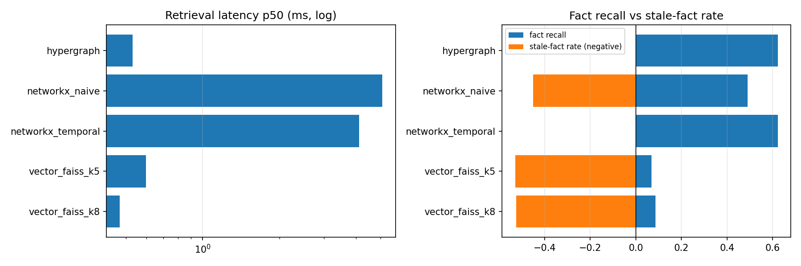
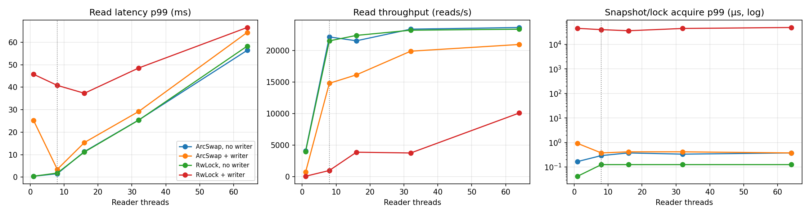
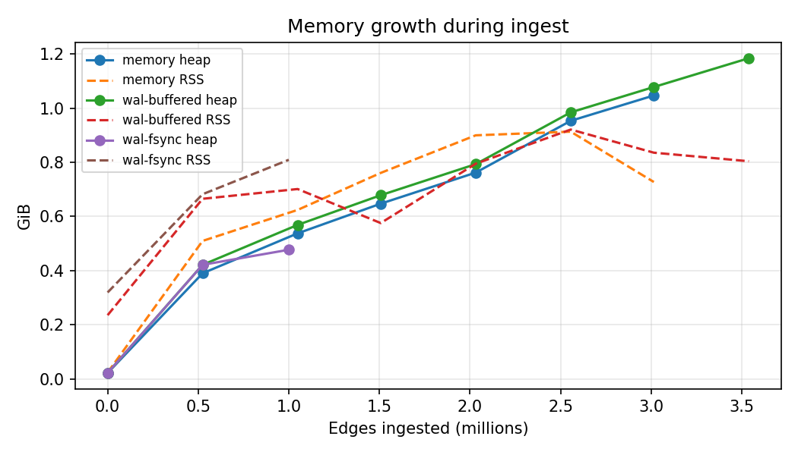
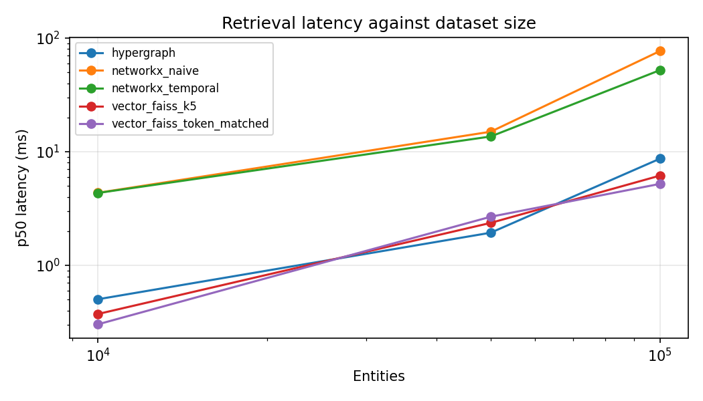
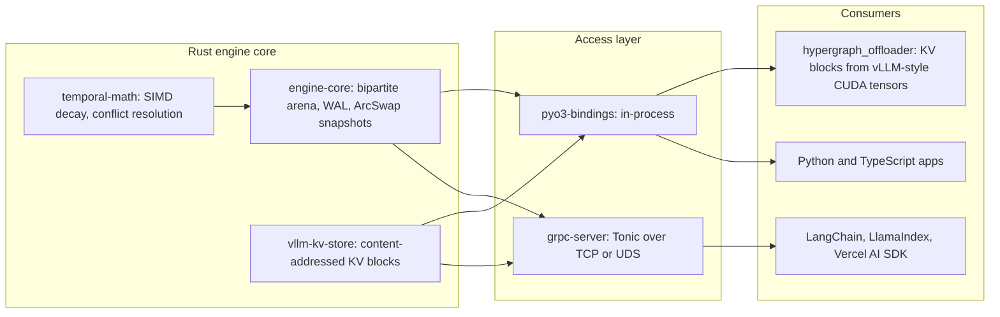

<div align="center">

# ⚡ Temporal Hypergraph Engine

**🌐 [temporal-hypergraph-web.onrender.com](https://temporal-hypergraph-web.onrender.com/)**

### Time-aware memory for LLMs that never serves a stale fact.

**A lock-free, SIMD-accelerated temporal hypergraph database written in Rust,<br/>with a zero-copy KV-cache block store for vLLM.**

[](LICENSE)
[](https://pypi.org/project/hypergraph-client/)
[](https://pypi.org/project/hypergraph-engine-native/)
[](https://www.npmjs.com/package/@temporal-hypergraph/sdk)
<br/>
[](https://github.com/Divyansh151005/Temporal-Hypergraph-Engine/actions/workflows/publish.yml)
[](https://github.com/Divyansh151005/Temporal-Hypergraph-Engine/actions/workflows/engine-validation.yml)
[](https://doc.rust-lang.org/edition-guide/rust-2021/)
[](https://pypi.org/project/hypergraph-engine-native/)

[**Live demo**](https://temporal-hypergraph-web.onrender.com/) · [**Try it**](#-try-it) · [**Quickstart**](#-quickstart) · [**Benchmarks**](#-benchmarks) · [**Architecture**](#-architecture) · [**Whitepaper**](docs/GTM_Whitepaper_Metrics.md) · [**Docs**](#-documentation) · [**License**](#-licensing-and-commercial-use)

</div>

<br/>

<table>
<tr>
<td align="center" width="33%">
<h2>0%</h2>
<b>stale facts</b> in multi-hop retrieval<br/>
<sub>vs 45.1% for Graph RAG and 52.5% for Vector RAG</sub>
</td>
<td align="center" width="33%">
<h2>7.8×</h2>
<b>faster</b> than a temporal property graph<br/>
<sub>0.53 ms vs 4.13 ms p50, identical accuracy</sub>
</td>
<td align="center" width="33%">
<h2>7.2×</h2>
<b>more facts recalled</b> than Vector RAG<br/>
<sub>62.2% vs 8.6% at a matched token budget</sub>
</td>
</tr>
<tr>
<td align="center">
<h2>375 ns</h2>
<b>p99 snapshot acquire</b> under a heavy writer<br/>
<sub>vs 48.9 ms for an <code>RwLock</code> (64 readers)</sub>
</td>
<td align="center">
<h2>10M</h2>
<b>hyperedges ingested in 85.6 s</b><br/>
<sub>117K/s sustained, 227K/s peak, 3.2 GiB RSS</sub>
</td>
<td align="center">
<h2>1,600</h2>
<b>KV blocks restored bit-exact</b> beside vLLM<br/>
<sub>500 generations, 0 mismatches, +0 B VRAM</sub>
</td>
</tr>
</table>

<div align="center"><sub>Measured offline with no LLM calls. Sources: <a href="docs/GTM_Whitepaper_Metrics.md">Phase 7 whitepaper</a> (Apple M3) and <a href="results/extreme_scale/">Kaggle extreme-scale run</a> (Tesla T4 instance). Methodology and limitations below.</sub></div>

---

## 🧭 Why temporal hypergraphs

Retrieval-augmented LLMs fail quietly when the knowledge base remembers facts that are no longer true. Ask a vector store *"who ran Microsoft in 2010?"* and it happily returns chunks about both Ballmer and Nadella; a naive graph traversal walks straight through superseded edges.

Temporal Hypergraph Engine stores knowledge as **time-bounded N-ary hyperedges**: one fact, any number of participants, a validity window. Every hop of a traversal is filtered by that window, so a query *as of* any instant only follows facts that were true then. Superseded facts are neither returned nor expanded.

```text
 CEO_OF  {person:ballmer, org:microsoft}   valid 2000-01-01 → 2014-02-01
 CEO_OF  {person:nadella, org:microsoft}   valid 2014-02-01 → ongoing

 traverse(["org:microsoft"], as_of=2010)   →  ballmer          (nadella is never touched)
 traverse(["org:microsoft"], as_of=2024)   →  nadella          (ballmer is never touched)
```

| Capability | Vector RAG | Graph RAG (property graph) | **Temporal Hypergraph** |
|---|:---:|:---:|:---:|
| Point-in-time queries enforced during traversal | ✗ | Manual filters | **✓ every hop** |
| N-ary facts kept intact (no reification) | ✗ | Event nodes | **✓ native hyperedges** |
| Multi-hop retrieval | ✗ | ✓ | **✓** |
| Readers never block on writers | n/a | Lock-based | **✓ ArcSwap snapshots** |
| In-process *and* networked access | Varies | Varies | **✓ PyO3 + gRPC** |
| KV-cache block tier for LLM serving | ✗ | ✗ | **✓ bit-exact on CUDA** |

## 📊 Benchmarks

Every workload is seeded and offline: no LLM or network calls during measurement. All contenders share one embedder, one tokenizer (`o200k_base`), the same seed entities and the same query plan. Full tables and methodology: **[docs/GTM_Whitepaper_Metrics.md](docs/GTM_Whitepaper_Metrics.md)**.

### 1. Retrieval accuracy: Graph RAG and Vector RAG

12,000 entities, 60,000 temporal facts (25,572 superseded or closed), 1,000 multi-hop questions about past dates where an outdated fact is usually a live distractor. Embedder: `all-MiniLM-L6-v2`. Hardware: Apple M3.

| Contender | p50 | p99 | Context tokens | Fact recall | Full-chain recall | F1 | Stale-fact rate |
|---|---:|---:|---:|---:|---:|---:|---:|
| ⚡ **Temporal Hypergraph (PyO3)** | **0.530 ms** | **11.1 ms** | 666 | **62.2%** | **36.2%** | **0.162** | **0.0%** |
| NetworkX property graph, temporal filter | 4.126 ms | 79.1 ms | 666 | 62.3% | 36.3% | 0.162 | 0.0% |
| NetworkX property graph, naive BFS (Graph RAG) | 5.082 ms | 78.8 ms | 689 | 49.0% | 11.8% | 0.118 | 45.1% |
| FAISS exact, k=5 (Vector RAG) | 0.598 ms | 3.25 ms | 403 | 6.9% | 0.7% | 0.015 | 52.9% |
| FAISS exact, token-matched k=8 (Vector RAG) | 0.472 ms | 2.96 ms | 656 | 8.6% | 1.4% | 0.012 | 52.5% |

<p align="center"></p>

How the hypergraph compares with each baseline:

| Baseline | Hypergraph faster (p50) | Recall gain | Recall ratio | Stale facts removed |
|---|---:|---:|---:|---:|
| Property graph, naive BFS | **9.6×** | +13.2 pts | 1.3× | −45.1 pts |
| Property graph, temporal filter | **7.8×** | −0.1 pts | 1.0× | — |
| FAISS exact, k=5 | 1.1× | +55.3 pts | **9.1×** | −52.9 pts |
| FAISS exact, token-matched k=8 | 0.9× | +53.6 pts | **7.2×** | −52.5 pts |

> [!NOTE]
> The temporal property graph applies the same validity filter and returns the same facts (mean Jaccard 0.983), so accuracy is identical by construction; that row isolates **engine speed**. Exact FAISS is slightly faster per query at small scale but recalls under a tenth of the facts. Hypergraph latency includes the PyO3 boundary and Python result conversion.

### 2. Lock-free reads under a heavy writer

N reader threads run 3-hop traversals over a 1,000,000-hyperedge graph while one writer inserts 1,024-edge batches back to back, unthrottled. The control runs the same workload over a conventional `RwLock`-protected graph. Hardware: Apple M3, 8 cores.

| Readers | ArcSwap reads/s | RwLock reads/s | ArcSwap read p99 | RwLock read p99 | **ArcSwap acquire p99** | RwLock acquire p99 |
|---:|---:|---:|---:|---:|---:|---:|
| 1 | 741/s | 89/s | 25.25 ms | 45.78 ms | **916 ns** | 45.19 ms |
| 8 | **14.8K/s** | 998/s | **3.46 ms** | 40.83 ms | **375 ns** | 40.01 ms |
| 16 | 16.2K/s | 3.9K/s | 15.40 ms | 37.32 ms | **416 ns** | 36.08 ms |
| 32 | 19.9K/s | 3.8K/s | 29.21 ms | 48.56 ms | **416 ns** | 44.70 ms |
| 64 | 21.0K/s | 10.1K/s | 64.39 ms | 66.58 ms | **375 ns** | 48.89 ms |

<p align="center"></p>

At 8 readers, ArcSwap delivers **14.8× the read throughput** and **11.8× lower read p99** than the `RwLock` control, and snapshot acquisition stays at a flat **~400 ns** at every reader count. The writer's cost to read p99 falls from +127.8% at 8 readers to +14.1% at 64, versus +2155% for the lock at 8 readers.

<details>
<summary><b>Steady-state writer (throttled to 10K edges/s)</b></summary>

| Readers | Writer throughput | ArcSwap read p99 | Read-p99 overhead from writer |
|---:|---:|---:|---:|
| 1 | 10.0K/s | 409.9 µs | +4.2% |
| 8 | 10.0K/s | 1.80 ms | +25.6% |
| 16 | 10.0K/s | 11.80 ms | +8.7% |
| 32 | 9.8K/s | 28.43 ms | +10.7% |
| 64 | 5.5K/s | 63.60 ms | +9.2% |

Above 8 readers, latency also rises from CPU time-slicing on this 8-core machine; that affects both designs equally and is not lock contention.

</details>

### 3. Ingest and durability

Synthetic temporal hyperedges (arity 2 to 4, 32 event types, 10% with a closed validity window) over 2,000,000 entities with power-law popularity skew. Batches of 65,536 edges; data generation is off the timed path. Hardware: Apple M3, 8 GiB RAM.

| Durability mode | Survives | Throughput (in RAM) | Peak (1 s) | Single-write p50 / p99 | Heap per 1M edges | WAL on disk |
|---|---|---:|---:|---:|---:|---:|
| `memory` | — | **200.0K/s** | **313.6K/s** | 26.0 µs / 2.21 ms | 322 MiB | n/a |
| `wal-buffered` | Process crash | 138.7K/s | 306.6K/s | 28.8 µs / 2.30 ms | 310 MiB | 487 MiB |
| `wal-fsync` | Power loss | 230.1K/s (1M edges) | 246.9K/s | 5.68 ms / 46.86 ms | 472 MiB | 185 MiB |

On the 8 GiB M3 the in-memory runs stopped at about 3M edges when the OS began paging; the harness stops rather than report swap-bound throughput. The 10M-edge run below was done on a larger machine.

<details>
<summary><b>Memory growth during ingest</b></summary>
<p align="center"></p>
</details>

### 4. Extreme scale (Kaggle, Tesla T4 instance)

4-vCPU Intel Xeon @ 2.0 GHz, 32 GB RAM, Tesla T4 16 GB. Ingest and retrieval run on the CPU; the soak test runs vLLM on the T4. Raw output: [`results/extreme_scale/`](results/extreme_scale/).

| Benchmark | Workload | Result |
|---|---|---|
| **10M-edge ingest** | 10,000,000 hyperedges over 2M nodes, in memory | **85.6 s**, ~117K edges/s sustained, **227K/s peak**, 3.21 GiB peak RSS, 0 failed inserts |
| **Temporal retrieval** | 100K entities, 500K facts, 1,000 three-hop questions | **2.95 ms p50**, **8.0×** faster than temporal NetworkX, **9.4×** faster than naive BFS, **0% stale facts** |
| **vLLM soak** | Qwen2.5-1.5B, 500 generations, a 32-block offload/restore every 10 | **1,600 blocks bit-exact**, 0 leftover, **+0 B VRAM**, +0.2 MiB anonymous heap |

<details>
<summary><b>Full 100K-entity retrieval table</b> (hashing embedder)</summary>

| Contender | p50 | p99 | Recall | F1 | Stale-fact rate |
|---|---:|---:|---:|---:|---:|
| ⚡ **Temporal Hypergraph** | **2.95 ms** | **119 ms** | **51.3%** | **0.125** | **0.0%** |
| NetworkX, temporal filter | 23.7 ms | 583 ms | 51.4% | 0.125 | 0.0% |
| NetworkX, naive BFS | 27.8 ms | 607 ms | 31.6% | 0.071 | 47.7% |
| FAISS exact, k=5 | 21.9 ms | 26.2 ms | 0.7% | 0.001 | 48.8% |
| FAISS exact, k=12 | 21.7 ms | 24.5 ms | 0.9% | 0.001 | 50.2% |

Absolute F1 is low because the graph contenders return a fixed context of up to 16 facts for questions with two gold facts, which caps precision at 12.5%. Recall and stale-fact rate are the metrics that matter for RAG context quality.

</details>

> [!NOTE]
> **Memory behavior.** Append-only segment storage uses file-backed pages. During the soak, resident memory grew by 618 MiB of file-backed pages, matching the 630 MiB of KV data appended, while anonymous heap grew by 0.2 MiB and VRAM by 0 B. Segment compaction is scheduled for v2.1.0.

### 5. Scaling with dataset size

| Entities | Facts | ⚡ Hypergraph | NetworkX naive | NetworkX temporal | FAISS k=5 | FAISS token-matched |
|---:|---:|---:|---:|---:|---:|---:|
| 10,000 | 50,000 | **0.504 ms** | 4.348 ms | 4.335 ms | 0.374 ms | 0.303 ms |
| 50,000 | 250,000 | **1.938 ms** | 15.0 ms | 13.6 ms | 2.364 ms | 2.678 ms |
| 100,000 | 500,000 | **8.670 ms** | 76.7 ms | 52.1 ms | 6.155 ms | 5.207 ms |

<p align="center"></p>

The hypergraph stays **6 to 9× ahead** of the graph baselines as the dataset grows 10×, and within the same order of magnitude as exact vector search while returning temporally correct, multi-hop context. (Sweep run on the M3 with a hashing embedder; the Kaggle run above used a different machine.)

<details>
<summary><b>Methodology, fairness and limitations</b></summary>

- **Offline and deterministic.** Every workload is seeded; no LLM or network calls happen during measurement.
- **Same inputs for every contender.** One embedder, one tokenizer and one rendering of facts into context text. Graph contenders get the same seed entities (oracle entity linking) and the same query plan.
- **Strong baselines.** The property graph reifies N-ary facts as event nodes with `valid_from`/`valid_to` properties, the standard Neo4j modelling, and its temporal variant applies the same validity filter as the engine. The vector baseline uses exact (brute-force) cosine search, so approximate-index recall loss does not penalise it.
- **Retrieval budget.** Graph contenders return the top 16 facts among those they reach; the vector contender returns the top 5 chunks, plus a token-matched k whose median context is at least the hypergraph's.
- **Latency** is in-process time of the retrieval call only; query embedding happens outside the timed region for every contender.
- **Limitations.** The data is synthetic and template-generated. Baselines are an in-process NetworkX property graph and exact FAISS, not Neo4j or a hosted vector database; network hops to a hosted service would add to their latency. Read p99 sits well above p50 because of snapshot reclamation on the read path and copy-on-write publish cost on large graphs; both are documented engineering notes in the whitepaper.

</details>

<details>
<summary><b>Reproduce every number</b></summary>

```bash
pip install -r benchmarks/requirements.txt
(cd crates/pyo3-bindings && maturin develop --release)

cargo bench -p thg-benchmarks --bench scale_stress -- \
  --edges 10000000 --modes memory,wal-buffered,wal-fsync --fsync-edges 1000000 \
  --out results/phase7/scale_stress.json
cargo bench -p thg-benchmarks --bench concurrency_scaling -- \
  --readers 1,8,16,32,64 --duration-secs 10 --preload 1000000 \
  --out results/phase7/concurrency.json
python -m hypergraph_evaluation.competitor_bench \
  --entities 12000 --facts 60000 --queries 1000 --hops 3 --top-k 16 \
  --embedder minilm --vector-backend faiss --out results/phase7/competitor.json
python -m hypergraph_evaluation.competitor_bench --scale-sweep 10000,50000,100000 \
  --embedder hashing --queries 500 --out results/phase7/competitor_sweep.json
python benchmarks/gtm_report.py --in results/phase7 --out docs/GTM_Whitepaper_Metrics.md
```

The Kaggle extreme-scale job lives in [`kaggle_extreme_tests/`](kaggle_extreme_tests/).

</details>

## 🏗 Architecture

```text
 ┌──────────────────────────────── Rust core engine ────────────────────────────────┐
 │                                                                                  │
 │   temporal-math                engine-core                     vllm-kv-store     │
 │  ┌──────────────────┐   ┌───────────────────────────┐   ┌─────────────────────┐  │
 │  │ SIMD time decay  │──▶│ Bipartite arena allocator │   │ BLAKE3 content-     │  │
 │  │ Fourier encoding │   │ ArcSwap lock-free index   │   │ addressed KV blocks │  │
 │  │ conflict resolve │   │ Write-ahead log + fsync   │   │ 64B-aligned mmap    │  │
 │  └──────────────────┘   │ Immutable read snapshots  │   │ append-only segments│  │
 │                         └─────────────┬─────────────┘   └──────────┬──────────┘  │
 └───────────────────────────────────────┼────────────────────────────┼─────────────┘
                     ┌───────────────────┴──────────┬─────────────────┘
                     ▼                              ▼
       ┌───────────────────────────┐   ┌───────────────────────────────┐
       │ pyo3-bindings (FFI)       │   │ grpc-server (Tonic)           │
       │ hypergraph_engine_native  │   │ TCP :50051 or Unix socket     │
       │ in-process, raw pointers  │   │ API-key auth, streaming       │
       └─────┬───────────────┬─────┘   └───────────────┬───────────────┘
             ▼               ▼                         ▼
 ┌───────────────────┐ ┌───────────┐   ┌──────────────────────────────────────────┐
 │ hypergraph-       │ │ Python    │   │ hypergraph-client · langchain-hypergraph │
 │ offloader         │ │ apps      │   │ llama-index-hypergraph · @temporal-      │
 │ CUDA ⇄ engine     │ │           │   │ hypergraph/sdk (Vercel AI SDK)           │
 │ KV blocks (vLLM)  │ │           │   │                                          │
 └───────────────────┘ └───────────┘   └──────────────────────────────────────────┘
```

- **Writes** append to a write-ahead log, land in the arena, and publish a new immutable snapshot with a single atomic pointer swap.
- **Reads** load the current snapshot without taking a lock, so a heavy writer never stalls a traversal.
- **Traversals** filter every hop by validity interval at `as_of`, then score by confidence times exponential time decay (and cosine similarity when you pass an embedding).
- **KV blocks** are keyed by a BLAKE3 hash of their token prefix, deduplicated, and can be tied to hyperedges so eviction uses the same temporal decay.

<details>
<summary>Mermaid version</summary>



</details>

## 🎮 Try it

The fastest way to see the engine is the **[interactive demo on the website](https://temporal-hypergraph-web.onrender.com/)**. Its Transit Diagram draws facts as a transit map; scrub the timeline to watch a point-in-time traversal redraw as superseded facts drop out. No install needed.

To run it yourself, follow the Quickstart below.

## 🚀 Quickstart

### 1. Start the server

The prebuilt image serves gRPC on `localhost:50051`; no Rust toolchain needed.

```bash
docker run -d -p 50051:50051 ghcr.io/divyansh151005/temporal-hypergraph-server:2.0.1
```

Add `-v thg-data:/data` to keep data across restarts and `-e HYPERGRAPH_API_KEY=your_key` to require a key. To build from source instead, run `docker build -t temporal-hypergraph-server .` or `cargo run --release -p grpc-server --bin hypergraph-server -- --data-dir ./data`.

### 2. Python: temporal facts and point-in-time traversal

```bash
pip install hypergraph-client
```

```python
from hypergraph_client import HypergraphClient, Hyperedge

Y2000, Y2010, Y2014 = 946684800, 1262304000, 1391212800  # Unix seconds

with HypergraphClient("localhost:50051") as client:
    client.insert(Hyperedge("CEO_OF", ["person:ballmer", "org:microsoft"], Y2000, Y2014,
                            summary="Steve Ballmer was CEO of Microsoft"))
    client.insert(Hyperedge("CEO_OF", ["person:nadella", "org:microsoft"], Y2014,
                            summary="Satya Nadella is CEO of Microsoft"))

    # Who ran Microsoft in 2010? Only facts valid at as_of are returned or expanded.
    # decay_lambda is per day; 0 selects the server default (30-day half-life).
    for edge in client.traverse(["org:microsoft"], k_hops=3, as_of=Y2010, decay_lambda=1e-6):
        print(edge.summary)  # -> Steve Ballmer was CEO of Microsoft
```

`AsyncHypergraphClient` offers the same methods for `asyncio`. See the [Python client README](integrations/python-client/README.md).

### 3. TypeScript

```bash
npm install @temporal-hypergraph/sdk
```

```ts
import { HypergraphClient } from "@temporal-hypergraph/sdk";

const client = new HypergraphClient({ endpoint: "localhost:50051", apiKey: process.env.HYPERGRAPH_API_KEY });

await client.insert({
  eventType: "CEO_OF",
  participants: ["person:nadella", "org:microsoft"],
  validFrom: 1391212800,
  summary: "Satya Nadella is CEO of Microsoft",
});

const facts = await client.traverse(["org:microsoft"], { kHops: 3 });
```

For Vercel AI SDK memory middleware and tools (`@temporal-hypergraph/sdk/ai`), see the [SDK README](integrations/vercel-ai-sdk/README.md). Node.js 18+; the `ai` subpath needs Node.js 22+.

### 4. vLLM KV-cache offloader

```bash
pip install hypergraph-offloader
```

```python
import torch
import hypergraph_engine_native as native
from hypergraph_offloader import HypergraphKVOffloader, KvLayout

layout = KvLayout(num_layers=28, block_size=16, num_heads=2, head_dim=128, dtype=torch.float16)
engine = native.NativeHypergraphEngine("./thg-data", sync="buffered")
offloader = HypergraphKVOffloader(engine, layout=layout)

key = offloader.hash_block_tokens(range(16))             # BLAKE3 over the token prefix
block = torch.randn(layout.shape, dtype=torch.float16, device="cuda")
offloader.offload_kv_tensor(key, block)                  # GPU -> pinned staging -> mmap segment

restored = torch.empty_like(block)
assert offloader.prefetch_kv_block(key, restored) and torch.equal(restored, block)
offloader.close()
```

> [!IMPORTANT]
> Verified bit-exact on a Tesla T4 alongside vLLM. The offloader is not yet registered as a vLLM KV connector; you call it from your own serving code. Connector registration is the next milestone. Design: [docs/04-vllm-kv-offloader.txt](docs/04-vllm-kv-offloader.txt).

<details>
<summary><b>LangChain, LlamaIndex and in-process (no server) one-liners</b></summary>

**LangChain** (`pip install langchain-hypergraph`)

```python
from langchain_hypergraph import TemporalHypergraph; memory = TemporalHypergraph(api_key="your_key", session_id="user-42")
```

**LlamaIndex** (`pip install llama-index-hypergraph`)

```python
from llama_index_hypergraph import TemporalHypergraph; memory = TemporalHypergraph(api_key="your_key", session_id="user-42")
```

**In-process, no server** (`pip install hypergraph-engine-native`)

```python
from hypergraph_engine_native import NativeHypergraphEngine

engine = NativeHypergraphEngine.in_memory()
engine.insert_hyperedge_fast("CEO_OF", ["person:nadella", "org:microsoft"], 1391212800, None, b"")
engine.traverse(["org:microsoft"], k_hops=3, as_of=1700000000, decay_lambda=1e-6)
```

</details>

Each integration has its own README with the full API: [Python client](integrations/python-client/README.md) · [LangChain](integrations/langchain/README.md) · [LlamaIndex](integrations/llamaindex/README.md) · [Vercel AI SDK](integrations/vercel-ai-sdk/README.md) · [native bindings](crates/pyo3-bindings/README.md) · [KV offloader](python/README.md)

## 📦 Packages

| Package | Registry | Purpose |
|---|---|---|
| `ghcr.io/divyansh151005/temporal-hypergraph-server` | GHCR | gRPC server image (amd64, arm64) |
| [`hypergraph-engine-native`](https://pypi.org/project/hypergraph-engine-native/) | PyPI | In-process PyO3 bindings and KV block store |
| [`hypergraph-client`](https://pypi.org/project/hypergraph-client/) | PyPI | Python gRPC client (sync and async) |
| [`langchain-hypergraph`](https://pypi.org/project/langchain-hypergraph/) | PyPI | LangChain chat memory and vector store |
| [`llama-index-hypergraph`](https://pypi.org/project/llama-index-hypergraph/) | PyPI | LlamaIndex retriever and chat memory |
| [`hypergraph-offloader`](https://pypi.org/project/hypergraph-offloader/) | PyPI | KV-cache block offloader for PyTorch and vLLM |
| [`@temporal-hypergraph/sdk`](https://www.npmjs.com/package/@temporal-hypergraph/sdk) | npm | TypeScript client and Vercel AI SDK memory |

## 🗺 Roadmap

- [x] Lock-free temporal hypergraph core with WAL durability (v2.0)
- [x] PyO3 and gRPC access, LangChain / LlamaIndex / Vercel AI SDK integrations
- [x] Bit-exact KV block offload verified beside vLLM on CUDA
- [ ] Segment compaction for the append-only KV store (v2.1.0)
- [ ] Registration as a vLLM KV connector
- [ ] Background snapshot reclaimer to take memory reclamation off the read path
- [ ] Publish-on-demand bulk-load mode to flatten copy-on-write cost on large graphs

## 🗂 Repository layout

| Path | Contents |
|---|---|
| [`crates/engine-core`](crates/engine-core) | Bipartite-arena hypergraph storage, WAL durability, lock-free snapshot reads |
| [`crates/temporal-math`](crates/temporal-math) | Time-decay scoring, Fourier time encodings, temporal conflict resolution |
| [`crates/grpc-server`](crates/grpc-server) | Tonic gRPC server (`hypergraph-server`) over TCP or Unix sockets |
| [`crates/pyo3-bindings`](crates/pyo3-bindings) | In-process Python module `hypergraph_engine_native` |
| [`crates/vllm-kv-store`](crates/vllm-kv-store) | Content-addressed, mmap-backed store for KV-cache blocks |
| [`python/hypergraph_offloader`](python/hypergraph_offloader) | Python KV-block offloader; verified bit-exact on CUDA alongside vLLM |
| [`python/evaluation`](python/evaluation) | Extraction, F1 evaluation, LLM failover router, competitor benchmark |
| [`integrations/`](integrations) | Python client, LangChain, LlamaIndex, Vercel AI SDK |
| [`benchmarks/`](benchmarks) | Scale, concurrency and report-generation benchmarks |
| [`proto/`](proto) | gRPC service definition |
| [`tests/`](tests) | Chaos (SIGKILL, WAL corruption) and Python integration tests |

## 🛠 Building from source

Requires Rust 1.80+, Python 3.10+, and Node 18+ for the TypeScript SDK.

```bash
cargo build --release --workspace
cargo test --workspace

python -m venv .venv && source .venv/bin/activate
pip install maturin
(cd crates/pyo3-bindings && maturin develop --release)
pip install -e integrations/python-client -e integrations/langchain -e integrations/llamaindex

(cd integrations/vercel-ai-sdk && npm ci && npm run build)
```

On macOS, see the [local development guide](docs/07-mac-local-development-guide.txt) for CPU fallbacks and remote GPU setup.

## 📚 Documentation

1. [Core storage engine](docs/01-core-storage-engine.txt)
2. [Temporal decay math](docs/02-temporal-decay-math.txt)
3. [gRPC and IPC API](docs/03-grpc-ipc-api.txt)
4. [vLLM KV offloader](docs/04-vllm-kv-offloader.txt)
5. [Extraction benchmarks](docs/05-extraction-benchmarks.txt)
6. [Test and validation plan](docs/06-test-and-validation-plan.txt)
7. [macOS local development guide](docs/07-mac-local-development-guide.txt)
8. [Performance and competitor metrics (whitepaper)](docs/GTM_Whitepaper_Metrics.md)

## 📜 Licensing and commercial use

Temporal Hypergraph Engine is licensed under the **[Server Side Public License, version 1](LICENSE) (SSPL-1.0)**.

| | |
|---|---|
| ✅ **Personal, academic and internal enterprise use** | Free. Run, modify, embed and deploy the engine inside your own applications, products and internal systems without paying for a license. |
| 🛡 **Cloud provider protection** | You may **not** offer the engine, or a modified version of it, to third parties as a managed or hosted service (database-as-a-service) unless you release the source code of your entire service stack under the SSPL, as Section 13 requires. That stack includes management, user-interface, API, automation, monitoring, backup and storage software. |
| 🔁 **Distributing modified versions** | Requires making their source available under the SSPL. |
| 🕰 **Legacy versions** | All pre-2.0.0 versions are deprecated and unsupported. Versions 1.0.1 and earlier were published under `MIT OR Apache-2.0`, and copies obtained under those terms remain available under them; 2.0.0 is the first release under the SSPL. |

The SSPL is not an OSI-approved open source license. This summary is for convenience only; the [license text](LICENSE) governs. For commercial or managed-service licensing, contact the maintainers.

External contributions require a Contributor License Agreement; see [CONTRIBUTING.md](CONTRIBUTING.md#contributor-license-agreement-cla).

<div align="center">
<br/>
<sub>Built in Rust 🦀 · If this saves your RAG pipeline from a stale fact, consider leaving a ⭐</sub>
</div>
