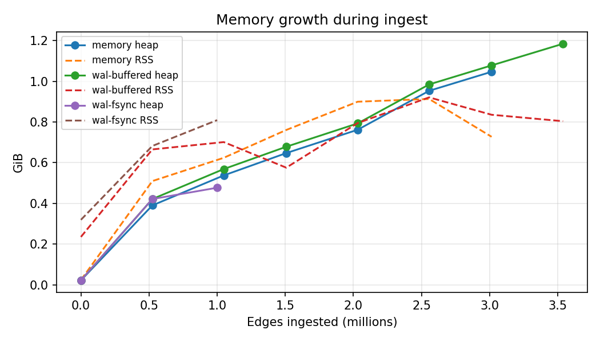
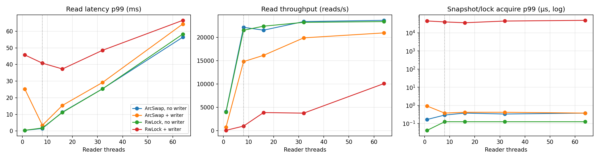
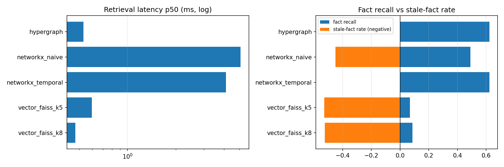
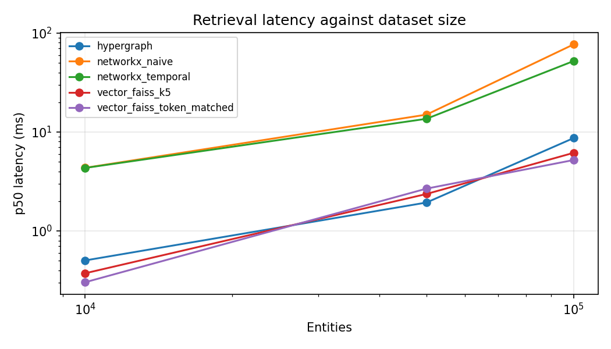

# Temporal Hypergraph Engine: Phase 7 Performance and Competitor Metrics

_Generated 2026-10-30 15:03 UTC by `benchmarks/gtm_report.py` from `results/phase7/`. Do not edit by hand; re-run the benchmarks and regenerate._

## Executive summary

- **Ingest:** 200.0 K/s sustained over the first 2,031,616 temporal hyperedges (peak 313.6 K/s), using 322 MiB of heap per million edges. The run stopped at 3,014,656 edges when this 8 GiB machine began paging; the 10,000,000-edge target needs about 3.1 GiB of heap.
- **Concurrency:** with 64 readers and a heavy writer, snapshot acquisition stays at 375 ns p99 under ArcSwap, against 48.89 ms for an RwLock. Readers sustain 21.0 K/s against 10.1 K/s (2.1x).
- **Retrieval:** 8x faster than the temporal property-graph baseline at identical accuracy; 0% stale facts against 45.1% for naive Graph RAG; 7x the multi-hop fact recall of the best vector setting (62.2% vs 8.6%).

## 1. Extreme-scale ingest

Synthetic temporal hyperedges (arity 2..=4, 32 event types, 10.0% with a closed validity window) over 2,000,000 entities with a power-law popularity skew of 2.0. Batches of 65,536 edges are produced on a separate thread, so data generation is not part of the timed path. Hardware: Apple M3, 8 cores, 8 GiB RAM, macos aarch64, rustc 1.91.1 (ed61e7d7e 2025-11-07) (Homebrew), git efd737f-dirty.

| Durability mode | Edges ingested | Throughput while in RAM | Throughput, whole run | Peak (1 s window) | Batch latency p50 / p99 (65,536 edges) | Single-write p50 / p99 | Heap per 1M edges | Peak RSS | WAL on disk |
|---|---|---|---|---|---|---|---|---|---|
| `memory` | 3,014,656 of 10,000,000 (stopped early*) | 200.0 K/s (first 2,031,616) | 88.1 K/s | 313.6 K/s | 396.36 ms / 3332.37 ms | 26.0 µs / 2.21 ms | 322 MiB | 0.91 GiB | n/a |
| `wal-buffered` | 3,538,944 of 10,000,000 (stopped early*) | 138.7 K/s (first 2,031,616) | 55.0 K/s | 306.6 K/s | 740.29 ms / 5507.12 ms | 28.8 µs / 2.30 ms | 310 MiB | 0.92 GiB | 487 MiB |
| `wal-fsync` | 1,000,000 | 230.1 K/s (first 1,000,000) | 230.1 K/s | 246.9 K/s | 271.84 ms / 347.08 ms | 5.68 ms / 46.86 ms | 472 MiB | 0.81 GiB | 185 MiB |

- `memory`: in-memory engine, no WAL. `wal-buffered`: WAL with OS-buffered writes (survives a process crash). `wal-fsync`: `fdatasync` on every committed batch (survives power loss).
- Single-write latency: 4 client threads each issue one `insert` at a time through the group-commit queue against a preloaded graph.
- Throughput while in RAM is the cumulative rate up to the last memory sample at which the live heap still fit in resident memory. The whole-run figure includes any time spent paging.
- Heap per 1M edges is the least-squares slope of live heap bytes (counting allocator) against edges ingested, so it excludes fixed start-up cost.

\* `memory` stopped at 3,014,656 edges: memory pressure: live heap 1072 MiB exceeds RSS 744 MiB, so the OS is paging the graph out. The harness stops rather than report throughput that is bound by swap.

\* `wal-buffered` stopped at 3,538,944 edges: memory pressure: live heap 1213 MiB exceeds RSS 823 MiB, so the OS is paging the graph out. The harness stops rather than report throughput that is bound by swap.

**Engineering note: bulk-load batch size.** Each committed batch publishes a new copy-on-write snapshot. The first write to a 64-node page after a publish copies that page, so a batch of random edges copies close to the whole node table once the graph has a few hundred thousand entities. Publish cost therefore grows with graph size, and bulk loads should use large batches to amortise it. Fewer, larger publishes per batch, or a publish-on-demand bulk-load mode, would flatten the curve below.

Memory samples, `memory` mode:

| Edges | Live heap | RSS |
|---|---|---|
| 0 | 0.02 GiB | 0.02 GiB |
| 524,288 | 0.39 GiB | 0.51 GiB |
| 1,048,576 | 0.54 GiB | 0.62 GiB |
| 1,507,328 | 0.65 GiB | 0.76 GiB |
| 2,031,616 | 0.76 GiB | 0.90 GiB |
| 2,555,904 | 0.95 GiB | 0.91 GiB |
| 3,014,656 | 1.05 GiB | 0.73 GiB |



## 2. Lock-free read concurrency

N reader threads run 3-hop traversals (capped at 1,024 hyperedges each) over a 1,000,000-hyperedge graph. In the writer scenarios one thread inserts 1,024-edge batches back to back, unthrottled. The control repeats the same workload over a conventional `RwLock`-protected graph, where the writer holds the write lock while it applies a batch. Hardware: Apple M3, 8 cores, 8 GiB RAM, macos aarch64, rustc 1.91.1 (ed61e7d7e 2025-11-07) (Homebrew), git efd737f-dirty.

| Readers | ArcSwap reads/s (no writer) | ArcSwap reads/s (+writer) | RwLock reads/s (+writer) | ArcSwap read p99 (no writer) | ArcSwap read p99 (+writer) | RwLock read p99 (+writer) | ArcSwap snapshot-acquire p99 (+writer) | RwLock lock-acquire p99 (+writer) |
|---|---|---|---|---|---|---|---|---|
| 1 | 4.1 K/s | 741/s | 89/s | 401.2 µs | 25.25 ms | 45.78 ms | 916 ns | 45.19 ms |
| 8 | 22.2 K/s | 14.8 K/s | 998/s | 1.52 ms | 3.46 ms | 40.83 ms | 375 ns | 40.01 ms |
| 16 | 21.5 K/s | 16.2 K/s | 3.9 K/s | 11.36 ms | 15.40 ms | 37.32 ms | 416 ns | 36.08 ms |
| 32 | 23.4 K/s | 19.9 K/s | 3.8 K/s | 25.41 ms | 29.21 ms | 48.56 ms | 416 ns | 44.70 ms |
| 64 | 23.6 K/s | 21.0 K/s | 10.1 K/s | 56.43 ms | 64.39 ms | 66.58 ms | 375 ns | 48.89 ms |

| Readers | ArcSwap read-p99 overhead from writer | RwLock read-p99 overhead from writer | Writer throughput (ArcSwap) | Writer throughput (RwLock) | ArcSwap read scaling efficiency |
|---|---|---|---|---|---|
| 1 | +6193.8% | +10724.2% | 34.8 K/s | 29.6 K/s | 100.0% |
| 8 | +127.8% | +2155.2% | 25.2 K/s | 31.3 K/s | 67.8% |
| 16 | +35.5% | +233.8% | 15.1 K/s | 29.7 K/s | 66.0% |
| 32 | +15.0% | +91.5% | 9.8 K/s | 30.0 K/s | 71.6% |
| 64 | +14.1% | +14.2% | 5.4 K/s | 19.7 K/s | 72.4% |

- Overhead is measured at a fixed reader count: read p99 with the writer divided by read p99 without it, minus 1. This machine has 8 cores, so above 8 readers latency also rises from time-slicing. That affects both designs equally and is not lock contention.
- Scaling efficiency is reads/s at N readers divided by (reads/s at 1 reader x min(N, cores)).
- Acquire timings include about 41 ns of timer overhead.

**Engineering note: snapshot reclamation.** Readers never block on the writer, so acquisition stays flat. The remaining read-tail overhead comes from memory reclamation. When the writer publishes, a reader still holding the previous snapshot becomes its last owner, and dropping the guard frees the retired copy-on-write pages on the read path. The guard-release p99 peaks at 24.87 ms (with 1 reader). Handing retired snapshots to a background reclaimer would take this cost off the read path.

Steady-state writer (throttled to 10,000 edges/s):

| Readers | Writer throughput | ArcSwap read p99 (+writer) | ArcSwap read-p99 overhead | RwLock read-p99 overhead |
|---|---|---|---|---|
| 1 | 10.0 K/s | 409.9 µs | +4.2% | n/a |
| 8 | 10.0 K/s | 1.80 ms | +25.6% | n/a |
| 16 | 10.0 K/s | 11.80 ms | +8.7% | n/a |
| 32 | 9.8 K/s | 28.43 ms | +10.7% | n/a |
| 64 | 5.5 K/s | 63.60 ms | +9.2% | n/a |



## 3. Retrieval against Graph RAG and Vector RAG

Offline, purely algorithmic retrieval (no LLM calls) over a dense synthetic temporal world: 12,000 entities, 60,000 facts (28,103 N-ary, 25,572 superseded or closed), mean entity degree 12.4 (max 2,876). The facts are written up as 10,538 articles, chunked into 17,278 chunks of about 85 tokens for the vector baseline. 1,000 multi-hop questions (mean 2.3 gold facts per question) each ask about a past date where an outdated fact is usually a live distractor. Embedder: `sentence-transformers/all-MiniLM-L6-v2` (384 dims), shared by every contender. Hardware: Apple M3, Darwin arm64, Python 3.10.13, git efd737f-dirty.

| Contender | Latency p50 | Latency p99 | Context tokens (mean) | Fact precision | Fact recall | F1 | Full-chain recall | Stale-fact rate |
|---|---|---|---|---|---|---|---|---|
| Temporal Hypergraph (PyO3) | 0.530 ms | 11.1 ms | 666 | 0.097 | 0.622 | 0.162 | 36.2% | 0.0% |
| NetworkX property graph (naive BFS) | 5.082 ms | 78.8 ms | 689 | 0.068 | 0.490 | 0.118 | 11.8% | 45.1% |
| NetworkX property graph (temporal filter) | 4.126 ms | 79.1 ms | 666 | 0.097 | 0.623 | 0.162 | 36.3% | 0.0% |
| Flat vector (FAISS exact, k=5) | 0.598 ms | 3.252 ms | 403 | 0.009 | 0.069 | 0.015 | 0.7% | 52.9% |
| Flat vector (FAISS exact, token-matched k=8) | 0.472 ms | 2.962 ms | 656 | 0.007 | 0.086 | 0.012 | 1.4% | 52.5% |

Temporal Hypergraph compared with each baseline:

| Baseline | Hypergraph faster (p50) | Hypergraph context tokens | Recall gain | Recall ratio | Stale-fact rate |
|---|---|---|---|---|---|
| NetworkX property graph (naive BFS) | 9.6x | 3.2% fewer | +13.2 pts | 1.3x | 45.1 pts lower |
| NetworkX property graph (temporal filter) | 7.8x | 0.0% more | -0.1 pts | 1.0x | 0.0 pts lower |
| Flat vector (FAISS exact, k=5) | 1.1x | 65.5% more | +55.3 pts | 9.1x | 52.9 pts lower |
| Flat vector (FAISS exact, token-matched k=8) | 0.9x | 1.6% more | +53.6 pts | 7.2x | 52.5 pts lower |

- **Retrieval budget:** both graph contenders start from the same seed entity and return the top 16 facts by cosine similarity among the facts they reach, using a planner-supplied hop count and relation types (as a text-to-Cypher step would provide). The vector contender returns the top 5 chunks, plus a token-matched k whose median context is at least the hypergraph's.
- **Parity check:** the engine and the temporal NetworkX graph return the same facts (mean Jaccard 0.983). Their accuracy is identical by construction; the difference between them is speed.
- **Vector precision and recall:** a chunk counts every fact it contains as retrieved.
- **Latency:** in-process time of the retrieval call only; query embedding happens outside the timed region for every contender. Hypergraph latency includes the PyO3 boundary and Python result conversion.



### Scaling with dataset size

| Entities | Facts | hypergraph p50 | networkx_naive p50 | networkx_temporal p50 | vector_faiss_k5 p50 | vector_faiss_token_matched p50 |
|---|---|---|---|---|---|---|
| 10,000 | 50,000 | 0.504 ms | 4.348 ms | 4.335 ms | 0.374 ms | 0.303 ms |
| 50,000 | 250,000 | 1.938 ms | 15.0 ms | 13.6 ms | 2.364 ms | 2.678 ms |
| 100,000 | 500,000 | 8.670 ms | 76.7 ms | 52.1 ms | 6.155 ms | 5.207 ms |

Sweep embedder: `hashing-384`. NetworkX contenders run the first 100 queries at each size.



## Methodology and fairness

- **Offline and deterministic.** Every workload is seeded. No LLM or network calls happen during measurement.
- **Same inputs for every contender.** All contenders share one embedder, one tokenizer (tiktoken `o200k_base`) and one rendering of facts into context text. The graph contenders get the same seed entities (oracle entity linking) and the same query plan.
- **Strong baselines.**
  - The property-graph baseline reifies N-ary facts as event nodes with `valid_from`/`valid_to` properties, the standard Neo4j modelling.
  - Its temporal variant applies the same validity filter as the engine.
  - The vector baseline uses exact (brute-force) cosine search, so approximate-index recall loss does not penalise it.
- **What the engine adds.** Temporal validity is enforced during traversal, so superseded facts are neither returned nor expanded. N-ary facts stay intact as single hyperedges. Traversal runs over immutable lock-free snapshots in native code.
- **Known limitations.**
  - The data is synthetic and template-generated.
  - Latency is single-process and in-memory; network hops to a hosted vector or graph database would add to the baselines' latency.
  - Concurrency numbers above the core count reflect CPU time-slicing as well as synchronization.

## Reproduce

```bash
pip install -r benchmarks/requirements.txt
(cd crates/pyo3-bindings && maturin develop --release)

cargo bench -p thg-benchmarks --bench scale_stress -- \
  --edges 10000000 --modes memory,wal-buffered,wal-fsync --fsync-edges 1000000 \
  --out results/phase7/scale_stress.json
cargo bench -p thg-benchmarks --bench concurrency_scaling -- \
  --readers 1,8,16,32,64 --duration-secs 10 --preload 1000000 \
  --out results/phase7/concurrency.json
cargo bench -p thg-benchmarks --bench concurrency_scaling -- \
  --readers 1,8,16,32,64 --duration-secs 10 --preload 1000000 --writer-rate 10000 \
  --out results/phase7/concurrency_throttled.json
python -m hypergraph_evaluation.competitor_bench \
  --entities 12000 --facts 60000 --queries 1000 --hops 3 --top-k 16 \
  --embedder minilm --vector-backend faiss --out results/phase7/competitor.json
python -m hypergraph_evaluation.competitor_bench --scale-sweep 10000,50000,100000 \
  --embedder hashing --queries 500 --out results/phase7/competitor_sweep.json
python benchmarks/gtm_report.py --in results/phase7 --out docs/GTM_Whitepaper_Metrics.md
```
