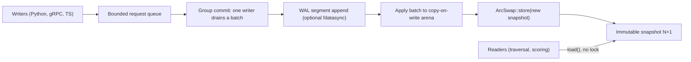
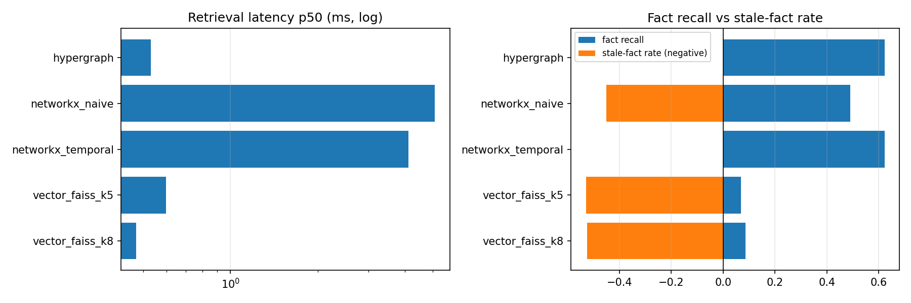
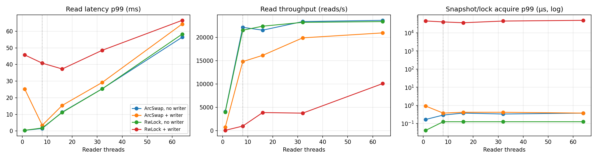

# Show HN: Temporal Hypergraph Engine, a lock-free temporal knowledge graph in Rust for LLM memory

**TL;DR**

- We built an embedded knowledge graph that stores facts as time-bounded N-ary hyperedges and enforces "was this true at time T?" *during* traversal, not after it.
- On a synthetic multi-hop benchmark of 1,000 questions about past dates, it returned 0% stale facts (naive graph RAG: 45.1%, vector RAG: 52.5% to 52.9%) and 7.2x the fact recall of vector RAG at the same context-token budget, with a 0.53 ms p50 retrieval latency including the Python boundary.
- Readers never take a lock. With 8 readers and a writer inserting as fast as it can, readers sustain 14.8K traversals/s. The same workload behind an `RwLock` manages 998/s.

Python and TypeScript SDKs are at v1.0.1. Everything below is reproducible from the repo, and the limitations are listed next to the claims.

---

## 1. The problem: retrieval that does not know what time it is

Ask an LLM agent "who ran the infrastructure team when the March outage happened?" The memory store has to return the fact that was true *in March*, not the one that is true today, and usually it has to hop through two or three related facts to get there.

**Vector RAG has no concept of validity time.** A chunk saying "Alice leads infrastructure" and a later chunk saying "Bob took over infrastructure" are both semantically close to the question. Cosine similarity cannot tell you which was true on a given date, so the superseded fact comes back as often as the current one. On our benchmark, an exact (brute-force, no ANN recall loss) FAISS index at k=5 returned stale facts at a rate of **52.9%**, and recovered only **6.9%** of the facts each multi-hop question needed.

**Graph RAG fixes the hops, not the time.** The standard property-graph modelling (the way you would do it in Neo4j) reifies each N-ary fact as an event node with `valid_from` / `valid_to` properties. The common query pattern is to traverse first and filter by time afterwards. That has two costs:

1. **Correctness.** If the filter is applied only to the final result set, the traversal has already *expanded through* superseded edges, and it pulls in neighbours that were only reachable via facts that were no longer true. Our naive BFS baseline returned **45.1%** stale facts.
2. **Latency.** If you filter at every hop instead, you get the right answer, but you pay for it on every edge you touch. Our temporally filtered baseline matched our accuracy exactly, at a p50 of **4.13 ms** against our **0.53 ms** (7.8x).

A note on honesty: our property-graph baseline is NetworkX implementing the Neo4j-style model in-process, not Neo4j itself. We did not benchmark Neo4j. A networked database would add round-trip latency on top of the numbers here, but it would also have a far more optimised traversal core than NetworkX, so treat the latency comparison as "same algorithm, native vs Python" rather than "us vs Neo4j".

## 2. The architecture

The engine is a Rust workspace. The parts that matter for this post:



### 2.1 `ArcSwap` snapshots for read-heavy workloads

AI memory is read-dominated: an agent retrieves on every turn and writes occasionally. So we optimised for readers and made the writer pay.

The graph lives in a bipartite arena (entity nodes on one side, hyperedges on the other), published as an immutable snapshot behind an [`ArcSwap`](https://docs.rs/arc-swap) ([`crates/engine-core/src/engine.rs`](../crates/engine-core/src/engine.rs)):

```rust
pub graph_snapshot: ArcSwap<BipartiteArena>,
```

A reader calls `graph_snapshot.load()`, gets a guard on the current snapshot, and traverses it without any lock. That snapshot cannot change underneath it.

Writers enqueue requests on a bounded channel. Whichever writer holds the writer lock drains the queue as one batch (group commit), appends it to the WAL, applies it to a writable copy of the arena, and publishes the result with a single `ArcSwap::store`. Copying a whole graph per batch would be absurd, so the arena is built from a persistent copy-on-write paged vector ([`crates/engine-core/src/paged.rs`](../crates/engine-core/src/paged.rs)) with 64-element pages. A write copies only the pages it touches that are still shared with an older snapshot.

Temporal validity is checked inside the traversal loop. A hyperedge whose `[valid_from, valid_to)` window does not contain the query's `as_of` timestamp is neither returned nor expanded. That single design choice accounts for the 0% stale rate, and it is also why we do not need a post-filter pass.

### 2.2 SIMD exponential time decay

Among the facts that *are* valid, newer ones usually matter more. Each candidate is scored as `cosine(query, embedding) * confidence * exp(-lambda * age_in_days)`. Ranking a large candidate set means computing a lot of exponentials, so [`crates/temporal-math/src/decay.rs`](../crates/temporal-math/src/decay.rs) has a vectorised `exp` specialised for this one job.

It processes 8 lanes at a time with `wide::f32x8` (AVX on x86_64, paired NEON registers on aarch64), runs two independent vectors per iteration to keep both FMA pipes busy, and finishes with a scalar tail. Because the exponent is always non-positive and clamped, the usual overflow, NaN and subnormal handling of a general `exp` can be dropped:

```rust
fn exp_nonpositive(x: f32x8, k: &ExpConsts) -> f32x8 {
    let n = (x * k.log2_e).round();
    let r = n.mul_neg_add(k.ln2_hi, x);
    let r = n.mul_neg_add(k.ln2_lo, r);
    let p = k.poly[0]
        .mul_add(r, k.poly[1])
        .mul_add(r, k.poly[2])
        .mul_add(r, k.poly[3])
        .mul_add(r, k.poly[4])
        .mul_add(r, f32x8::ONE)
        .mul_add(r, f32x8::ONE);
    let biased: i32x8 = (n.round_int() + k.bias) << 23;
    p * bytemuck::cast::<i32x8, f32x8>(biased)
}
```

This is standard range reduction: `x = n*ln2 + r` with `|r| <= ln2/2`, a degree-6 polynomial for `exp(r)` (relative truncation error below 2e-7), and `2^n` written straight into the exponent bits. A test checks it against `std` `exp` on 10K random deltas, and a `scalar-fallback` feature swaps in the plain version.

### 2.3 The PyO3 bridge and the vLLM KV offloader

Most users reach the engine from Python, so the FFI boundary matters. In [`crates/pyo3-bindings/src/lib.rs`](../crates/pyo3-bindings/src/lib.rs):

- Embeddings come in through the buffer protocol (`PyBuffer`), so a NumPy array or `bytes` object is read without an intermediate Python list.
- Every call into the engine runs inside `py.allow_threads(...)`, which releases the GIL. Python threads calling `retrieve` really do run in parallel on the lock-free read path.
- Retrieval results are converted into Python objects on the way out. That cost is not zero, and it *is* included in the 0.53 ms p50 below.

The same extension also exposes a KV-cache block store ([`crates/vllm-kv-store/`](../crates/vllm-kv-store/)) that [`python/hypergraph_offloader/`](../python/hypergraph_offloader/) plugs into vLLM as a secondary tier for PagedAttention blocks. This is the genuinely zero-copy path. `store_kv_block_raw` and `load_kv_block_raw` take a raw pointer and length (for example `torch.Tensor.data_ptr()`) and copy straight between the tensor's memory and 64-byte-aligned, append-only `mmap` segments, with no intermediate Python `bytes`. Blocks can be tied to hyperedges, so the eviction planner can use the same temporal decay to decide which cached contexts have gone cold. All of the crate's `unsafe` code lives in one module (`raw.rs`), and the test suite runs under Miri.

## 3. The numbers

Hardware for everything below: Apple M3, 8 cores, 8 GiB RAM, macOS. The full report, including methodology and every raw table, is [`docs/GTM_Whitepaper_Metrics.md`](GTM_Whitepaper_Metrics.md). It is generated by a script from the benchmark JSON, not written by hand.

### 3.1 Retrieval quality and latency

The dataset is a dense synthetic temporal world: 12,000 entities and 60,000 facts, of which 28,103 are N-ary and 25,572 are superseded or closed. There are 1,000 multi-hop questions, each about a past date where an outdated fact is usually a live distractor. Every contender uses the same embedder (`all-MiniLM-L6-v2`), the same tokenizer, and the same fact rendering. There are no LLM calls, so the numbers measure retrieval only.

| Contender | p50 | p99 | Context tokens (mean) | Fact recall | Full-chain recall | Stale-fact rate |
|---|---|---|---|---|---|---|
| **Temporal Hypergraph (PyO3)** | **0.530 ms** | 11.1 ms | 666 | **62.2%** | **36.2%** | **0.0%** |
| NetworkX property graph (naive BFS) | 5.082 ms | 78.8 ms | 689 | 49.0% | 11.8% | 45.1% |
| NetworkX property graph (temporal filter) | 4.126 ms | 79.1 ms | 666 | 62.3% | 36.3% | 0.0% |
| Flat vector, FAISS exact, k=5 | 0.598 ms | 3.252 ms | 403 | 6.9% | 0.7% | 52.9% |
| Flat vector, FAISS exact, token-matched k=8 | 0.472 ms | 2.962 ms | 656 | 8.6% | 1.4% | 52.5% |

How to read this:

- **Against vector RAG, the win is recall per token, not fewer tokens.** At a matched budget (666 vs 656 tokens), the hypergraph recovers 62.2% of the needed facts against 8.6%, which is 7.2x. The k=5 vector setup uses fewer tokens (403), but it recovers 6.9% of the facts and more than half of what it does return is stale.
- **Against the temporally correct graph baseline, the win is purely speed.** The two return the same facts (mean Jaccard 0.983), so accuracy is identical by construction. Our p50 is 7.8x lower.
- **Our p99 (11.1 ms) is worse than vector search's (3.3 ms).** Our working explanation is high-degree hub entities (max degree 2,876), which make some traversals far more expensive than the median. A flat vector index does the same amount of work for every query.



### 3.2 Concurrency: `ArcSwap` against `RwLock`

N reader threads run 3-hop traversals (capped at 1,024 hyperedges each) over a 1,000,000-hyperedge graph. One writer inserts 1,024-edge batches back to back, unthrottled. The control is the same graph behind a conventional `RwLock`, where the writer holds the write lock while it applies a batch.

| Readers | Design | Reads/s (+writer) | Snapshot / lock acquire p99 | Full read p99 |
|---|---|---|---|---|
| 8 | `ArcSwap` | **14.8 K/s** | **375 ns** | **3.46 ms** |
| 8 | `RwLock` | 998/s | 40.01 ms | 40.83 ms |
| 64 | `ArcSwap` | 21.0 K/s | 375 ns | 64.39 ms |
| 64 | `RwLock` | 10.1 K/s | 48.89 ms | 66.58 ms |

At 8 readers (one per core), the `RwLock` readers spend almost all of their p99 waiting for the lock. The `ArcSwap` readers acquire a snapshot in under a microsecond (the figure includes about 41 ns of timer overhead) and spend their time actually traversing. At 64 readers the machine is 8x oversubscribed, and both designs' tails are dominated by time-slicing rather than synchronisation. The throughput gap (2.1x) remains.

There is a trade-off. The `ArcSwap` writer is slower under heavy read load (5.4 K/s against 19.7 K/s at 64 readers), because publishing a snapshot copies the shared pages it touches and readers keep old snapshots alive. We think that is the right trade-off for agent memory, but it is a trade-off.



### 3.3 Ingest

Synthetic hyperedges (arity 2 to 4) over 2,000,000 entities with power-law popularity:

| Durability mode | Sustained throughput | Single-write p50 / p99 |
|---|---|---|
| In-memory, no WAL | 200.0 K/s (first 2.03M edges) | 26.0 µs / 2.21 ms |
| WAL, OS-buffered | 138.7 K/s (first 2.03M edges) | 28.8 µs / 2.30 ms |
| WAL, `fdatasync` per batch | 230.1 K/s (1M edges) | 5.68 ms / 46.86 ms |

The fsync run being the fastest is not a typo. It was capped at 1M edges, and the other runs slow down as the graph grows (see section 4).

## 4. What is still slow, or not yet proven

- **Vector search is faster at the median.** Token-matched FAISS has a p50 of 0.472 ms against our 0.530 ms. If your questions are single-hop and not time-sensitive, a flat vector index is simpler and fine.
- **The read tail comes from memory reclamation.** When the writer publishes, a reader holding the previous snapshot can become its last owner. Dropping the guard then frees the retired copy-on-write pages *on the read path*: guard-release p99 peaks at 24.87 ms. Handing retired snapshots to a background reclaimer is the obvious fix, and we have not built it yet.
- **Publish cost grows with graph size.** With random edges, the first write to each page after a publish copies it, so a batch eventually copies close to the whole node table. Bulk loads need large batches for now.
- **We did not reach 10M edges.** The 10M-edge ingest run stopped at about 3M edges when the 8 GiB machine started paging. The harness refuses to report swap-bound throughput. At 322 MiB of heap per million edges, 10M edges needs about 3.1 GiB of heap.
- **The data is synthetic**, and every number is single-process and in-memory. Real corpora are messier, and we would like to hear how it behaves on yours.

## 5. The "oops" moment: a recovery bug that deleted committed writes

The bug we are least proud of turned up while we were building the chaos test suite. That suite includes a WAL corruptor that sweeps every frame against every fault type and checks recovery against an independent oracle ([`crates/engine-core/tests/chaos_wal_corruptor.rs`](../crates/engine-core/tests/chaos_wal_corruptor.rs)), plus a SIGKILL harness that kills the server mid-write over and over.

**The setup.** `checkpoint()` writes a snapshot, opens a new WAL segment, and then deletes the old segments it supersedes. If the process dies between "open new segment" and "delete old segment", both segments survive. The old one is harmless, because the checkpoint already covers everything in it.

**The bug.** Recovery had a simple and apparently conservative rule: if a segment is corrupt, discard every segment after it, because you cannot safely replay past a hole in the log. Now corrupt that leftover, already-checkpointed segment with any fault the corruptor injects: a flipped bit, a damaged header field, or a truncated frame. Recovery sees the corruption and then deletes the *newer* segment, which held writes committed after the checkpoint. The engine opened cleanly, reported no error, and had silently lost acknowledged data.

**The fix.** The rule we actually meant was "never replay past a gap in the sequence numbers", not "never replay past a corruption". A corruption confined to frames the checkpoint already covers leaves the next segment contiguous with what has been applied. So recovery now discards a following segment only if it would *not* continue the sequence ([`crates/engine-core/src/engine.rs`](../crates/engine-core/src/engine.rs)):

```rust
for (start_seq, path) in wal::list_segments(&dir)? {
    // A corruption confined to frames a checkpoint already covers
    // leaves later segments contiguous; anything else would replay
    // past a gap of lost committed frames.
    if corrupted && start_seq != last_applied + 1 {
        warn!(segment = %path.display(), "discarding WAL segment that follows a corruption");
        fs::remove_file(&path)?;
        continue;
    }
    // ... replay; any batch whose first sequence id is not
    // last_applied + 1 fails recovery with "WAL sequence gap"
}
```

Two tests pin it down. `corruption_in_superseded_segment_keeps_checkpoint_and_followers` reproduces the crash window (checkpoint, more writes, resurrect and corrupt the old segment) and failed before the fix. `corruption_with_uncovered_loss_discards_followers` checks the other direction: when the corruption really does lose committed frames that no checkpoint covers, the later segment is still discarded rather than replayed across the hole.

The lesson we took from it is that "conservative" recovery rules are not automatically safe. Deleting data is also a failure mode, and a rule that is stricter than the invariant it protects can destroy the very writes it was meant to keep.

## 6. Try it

```bash
pip install hypergraph-engine-native
```

```bash
npm install @temporal-hypergraph/sdk
```

Repository: [github.com/Divyansh151005/Temporal-Hypergraph-Engine](https://github.com/Divyansh151005/Temporal-Hypergraph-Engine)

To reproduce the numbers above:

```bash
pip install -r benchmarks/requirements.txt
(cd crates/pyo3-bindings && maturin develop --release)

cargo bench -p thg-benchmarks --bench concurrency_scaling -- \
  --readers 1,8,16,32,64 --duration-secs 10 --preload 1000000 \
  --out results/phase7/concurrency.json
python -m hypergraph_evaluation.competitor_bench \
  --entities 12000 --facts 60000 --queries 1000 --hops 3 --top-k 16 \
  --embedder minilm --vector-backend faiss --out results/phase7/competitor.json
```

The full command list is in [`docs/GTM_Whitepaper_Metrics.md`](GTM_Whitepaper_Metrics.md#reproduce).

We would especially like criticism of the benchmark methodology. If you think a baseline is unfair, or you know of a workload where this design falls over, please open an issue or reply here. We would rather hear it now.
